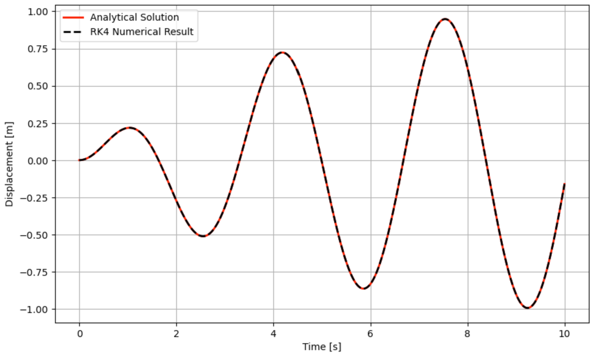
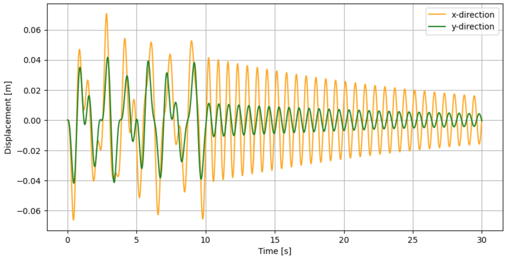
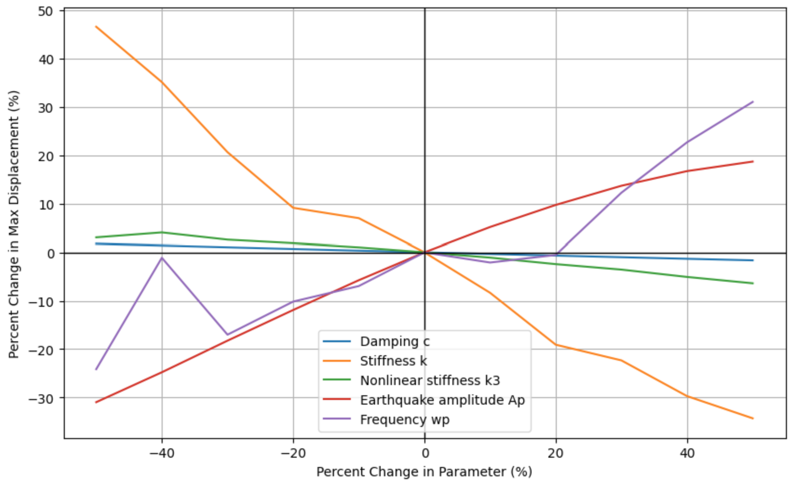

# rk4-structural-solver
Custom Python Fourth-Order Runge-Kutta (RK4) solver for modeling nonlinear building response under earthquake loading, including analytical verification and parameter sensitivity analysis.

## Mathematical Model

The 30m mid-rise steel frame is modeled as a bi-directional single-degree-of-freedom (SDOF) nonlinear Duffing oscillator subjected to rotated multi-harmonic ground acceleration $a_g(t)$:

$$m\ddot{x} + c\dot{x} + kx + k_3 x^3 = -m a_{g,x}(t)$$

$$m\ddot{y} + c\dot{y} + ky + k_3 y^3 = -m a_{g,y}(t)$$

where:
- $m = 2.0 \times 10^6\text{ kg}$ is the effective building mass
- $c = 2.0 \times 10^5\text{ N}\cdot\text{s/m}$ is the viscous damping coefficient
- $k = 1.5 \times 10^8\text{ N/m}$ is the linear lateral stiffness
- $k_3 = 1.0 \times 10^{10}\text{ N/m}^3$ is the nonlinear cubic stiffness coefficient

### State-Space Formulation

To integrate the system using a fixed-step RK4 scheme ($h = 0.01\text{ s}$), the coupled second-order equations are reduced to a 4-variable first-order state-space system $\dot{\mathbf{u}} = \mathbf{f}(t, \mathbf{u})$ with $\mathbf{u} = [x,\ v_x,\ y,\ v_y]^T$:

$$\begin{aligned}
\dot{x} &= v_x \\
\dot{v}_x &= -\frac{c}{m}v_x - \frac{k}{m}x - \frac{k_3}{m}x^3 - a_{g,x}(t) \\
\dot{y} &= v_y \\
\dot{v}_y &= -\frac{c}{m}v_y - \frac{k}{m}y - \frac{k_3}{m}y^3 - a_{g,y}(t)
\end{aligned}$$

## Numerical Verification

- **Analytical Benchmark ($k_3 = 0$):** Verified against the exact closed-form solution for a damped, harmonically forced linear oscillator, yielding a maximum absolute error of $\sim 10^{-7}\text{ m}$ ($0.000001\%$ difference).
- **Time-Step Convergence:** Refining the step size below $h = 0.01\text{ s}$ changes peak displacement by $< 0.25\%$.

## Simulation Results & Parameter Sensitivity

- **Structural Response:** Peak lateral displacement reached $0.0707\text{ m}$ ($11.7\%$ of the ASCE 7-16 allowable drift limit), while peak acceleration reached $7.07\text{ m/s}^2$ ($\approx 0.72g$).

- **Parameter Sensitivity ($\pm 50\%$ Sweep):** Linear stiffness ($k$) and primary forcing frequency ($\omega_p$) were the dominant drivers of peak displacement, while nonlinear hardening ($k_3$) constrained maximum lateral drift under extreme shaking.

